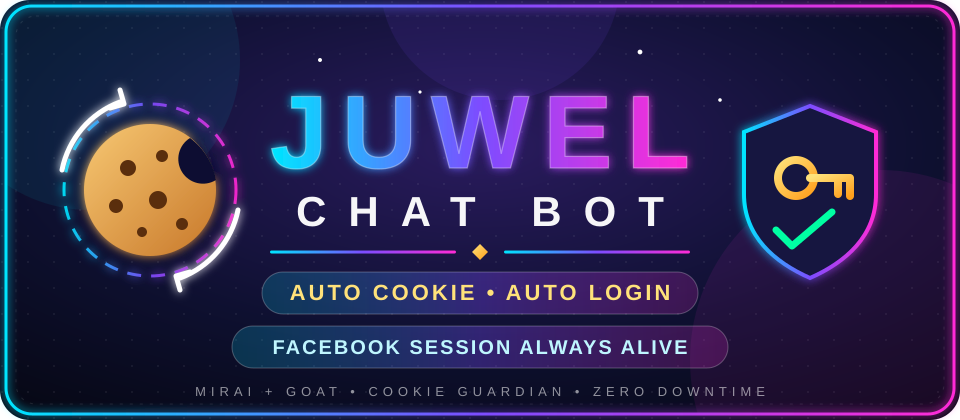

<!-- ═══════════════ HEADER WAVE ═══════════════ -->
<p align="center">
  
</p>

<!-- ═══════════════ LOGO: Mirai + Goat + JUWEL / MR JUWEL BOT ═══════════════ -->
<p align="center">
  
</p>

<h1 align="center">𝙼𝚁 𝙹𝚄𝚆𝙴𝙻</h1>
<h3 align="center">⚡ Ultra Premium Messenger Automation System</h3>

<!-- HERO ANIMATION -->
<p align="center">
  
</p>

<p align="center">
  
  
  
  
  
</p>

> ## 🤖🐐 Mirai-Goat-Mix
> এই ফর্কে **Mirai** ও **GoatBot** দুই ধরনের কমান্ড/ইভেন্টই চলে — `Script/commands` ও `Script/events` এ যেকোনো একটার কোড রাখলেই কাজ করবে।
>
> This fork runs **both Mirai and GoatBot** commands/events — drop either style into `Script/commands` or `Script/events`.
>
> 📖 Details: **[GOAT_COMPAT.md](GOAT_COMPAT.md)** · Start with `npm install` then `npm start`.

---

<!-- BANNER -->
<p align="center">
  
</p>
<p align="center">
  
</p>
<p align="center">
  
</p>

<!-- VISITOR -->
<p align="center">
  
</p>

---

<!-- ═══════════════ AUTO COOKIE + AUTO LOGIN ═══════════════ -->
<p align="center">
  
</p>

<h1 align="center">🍪 AUTO COOKIE &amp; AUTO LOGIN</h1>

<p align="center">
  
</p>

<p align="center">
  
  
  
  
</p>

<table align="center">
<tr>
<td align="center" width="25%">

### 🍪 Auto Cookie
ব্রাউজার থেকে ফেসবুক কুকি নিজে নিয়ে `appstate.json` সবসময় নতুন রাখে।

</td>
<td align="center" width="25%">

### 🔐 Auto Login
আইডি লগআউট হলে ইমেইল/নম্বর ও পাসওয়ার্ড দিয়ে নিজে লগইন করে নতুন কুকি নেয়।

</td>
<td align="center" width="25%">

### 🔑 2FA Ready
Authenticator সিক্রেট কী দিলে 2FA কোডও নিজে বসিয়ে দেয়।

</td>
<td align="center" width="25%">

### ♻️ Self Recovery
বটের লগে সেশন মরলে সাথে সাথে কুকি রিফ্রেশ, দরকারে বট রিস্টার্ট।

</td>
</tr>
</table>

### ⚙️ কীভাবে চালু করবেন

| ধাপ | কাজ |
|:---|:---|
| 1️⃣ | `guardian/` ফোল্ডারের ৫টা ফাইল রিপোতে থাকতে হবে |
| 2️⃣ | হোস্টের **Environment Variables**-এ দিন: `FB_EMAIL`, `FB_PASSWORD`, `FB_TOTP_SECRET` *(2FA থাকলে)* |
| 3️⃣ | হোস্টে একবার চালান: `npm i --no-save playwright && npx playwright install chromium` |
| 4️⃣ | Start Command দিন: `node guardian/start.js` |

> ⚠️ **নিরাপত্তা:** পাসওয়ার্ড কখনো `guardian/AUTO_COOKIE.js`-এ লিখে GitHub-এ কমিট করবেন না। হোস্টের Variables-এ দিন।
>
> 🧠 ফেসবুক ক্যাপচা বা পরিচয় যাচাই চাইলে অটো-লগইন থেমে যায়, তখন নিজে যাচাই শেষ করতে হবে।

---

<!-- ═══════════════ TELEGRAM START/STOP NOTICE ═══════════════ -->
<p align="center">
  
</p>

<h1 align="center">📡 TELEGRAM START / STOP NOTICE</h1>

<p align="center">
  
  
  
  
</p>

<p align="center"><b>MR JUWEL</b> — বট চালু/বন্ধ হলে, ফেসবুক আইডি লক বা লগআউট হলে সাথে সাথে আপনার <b>Telegram</b>-এ নোটিশ যায়।</p>

| নোটিশ | কখন যায় |
|:---|:---|
| 🟢 **STARTED** | বট লগইন করে চালু হলে |
| 🔴 **STOPPED** | বট বন্ধ/ক্র্যাশ হলে (কারণ ও কতক্ষণ চালু ছিল সহ) |
| 🚨 **ALERT** | আইডি লক/সেশন সমস্যা ধরা পড়লে |
| ✅ **BACK ONLINE** | সমস্যা মিটে বট ঠিকভাবে চললে |

### ⚙️ কীভাবে চালু করবেন

| ধাপ | কাজ |
|:---|:---|
| 1️⃣ | Telegram-এ **@BotFather** থেকে বট বানিয়ে **Token** নিন |
| 2️⃣ | সেই বটকে একবার `/start` দিন এবং আপনার **Chat ID** নিন |
| 3️⃣ | `config.json`-এর `JUWEL_ALERT` অংশে `TG_TOKEN` ও `TG_CHAT` বসান *(অথবা হোস্টের Variables-এ `JUWEL_TG_TOKEN`, `JUWEL_TG_CHAT`)* |
| 4️⃣ | বট চালু করে `juwelalert test` দিন — Telegram-এ টেস্ট নোটিশ আসবে |

> ⚠️ **নিরাপত্তা:** Telegram Token কখনো পাবলিক GitHub-এ কমিট করবেন না। হোস্টের **Environment Variables** ব্যবহার করুন।

---

<h1 align="center">🚀 PROJECT STATUS</h1>

<p align="center">
  
  
  
  
  
  
</p>

<table align="center">
<tr>
<td align="center"><h2>270+</h2><b>Commands</b></td>
<td align="center"><h2>15+</h2><b>No-Prefix Triggers</b></td>
<td align="center"><h2>10+</h2><b>Event Handlers</b></td>
<td align="center"><h2>25+</h2><b>Banner / Frame Makers</b></td>
<td align="center"><h2>10+</h2><b>AI Tools</b></td>
</tr>
</table>

---

<h1 align="center">📌 ABOUT BOT</h1>

<p align="center">
  
</p>

<h3 align="center">
  <b>JUWEL CHAT BOT</b> একটি advanced Messenger automation system যা<br/>
  group এবং inbox <b>smartভাবে control</b> করে। 🎯
</h3>

---

<h1 align="center">✨ FEATURES</h1>

<p align="center">
  
</p>

<table align="center">
<tr>
<td align="center" width="33%">

### 🤖 Auto Reply
Auto-response system + AI auto-teach chat with typing effect।

</td>
<td align="center" width="33%">

### 🎮 Quiz & Games
Bangla quiz, casino, Bầu Cua — Messenger-এই, কোনো ইনস্টলেশন ছাড়াই!

</td>
<td align="center" width="33%">

### 💰 Economy
Daily coins + streak bonus, Rank card, EXP/Level সিস্টেম।

</td>
</tr>
<tr>
<td align="center">

### 👥 Group Management
Add/kick/lock/tag/rename/emoji/image — সব এক জায়গায়।

</td>
<td align="center">

### 📥 Media Downloader
YouTube, Facebook, TikTok সহ **HD ভিডিও ও অডিও** ডাউনলোড।

</td>
<td align="center">

### ⚡ Fast Response
হাই-স্পিড রেসপন্স ইঞ্জিন + Auto reconnect।

</td>
</tr>
<tr>
<td align="center">

### 🖼️ Photo Editing
4K upscale, AI edit, art style — আলাদা অ্যাপ লাগবে না।

</td>
<td align="center">

### 🎨 Image Generation
Text-to-image: Flux, Pollinations ও GPT-gen।

</td>
<td align="center">

### 😂 Fun Commands
Slap, hug, pet, jail, meme template — **শত শত** ফান কমান্ড!

</td>
</tr>
<tr>
<td align="center">

### ⚡ No Prefix
`/` ছাড়াই শব্দ/ইমোজি লিখলেই বট রেসপন্স করে।

</td>
<td align="center">

### 📥 Inbox Support
ইনবক্সেও কমান্ড কাজ করে + অ্যাডমিন ইনবক্স ফরওয়ার্ড।

</td>
<td align="center">

### 🛡️ Security Shield
Anti-flood, anti-spam ban, anti-out, anti-join, Guardian।

</td>
</tr>
<tr>
<td align="center">

### 🔀 Hybrid Engine
Mirai + GoatBot কমান্ড/ইভেন্ট একসাথে।

</td>
<td align="center">

### 🕌 Islamic Pack
Ramadan auto-time, সূরা, Islamic video।

</td>
<td align="center">

### 🌐 24/7 Uptime
Render / Railway / Heroku-তে সারাক্ষণ অনলাইন।

</td>
</tr>
</table>

### 🔥 Quick Highlights

**• Auto Chat** — Enjoy automatic and seamless conversations through natural language processing.<br/>
**• Photo Editing** — Edit professional quality photos using our advanced commands, no additional apps needed.<br/>
**• Image Generation** — Create unique images using our cutting-edge text-to-image technology.<br/>
**• Video Downloader** — Download HD videos from YouTube, Facebook, TikTok and other platforms.<br/>
**• Interactive Games** — Play fun games directly in messenger, no installation hassle!<br/>
**• Fun Commands** — Surprise your friends with hundreds of fun commands!

---

<h1 align="center">⚡ NO PREFIX SYSTEM</h1>

<p align="center">
  
</p>

প্রিফিক্স (`/`) ছাড়াই এই কমান্ডগুলো নিজে থেকে কাজ করে — শুধু মেসেজে ট্রিগার লিখলেই হবে।

| Trigger / Command | কাজ |
|:---:|:---|
| `jwl` | "জুয়েল" লিখলে ☠️ রিয়েক্ট দেয় |
| `autoreplybot` | নির্দিষ্ট ট্রিগার শব্দে অটো-রিপ্লাই |
| `autovoice` | অটো ভয়েস রিপ্লাই |
| `baby` | AI auto-teach চ্যাট + typing effect |
| `Gan` | প্রিফিক্স ছাড়াই র‍্যান্ডম গান |
| `umma` · `night` · `women` | ফান অটো-রেসপন্স |
| `👀` · `😅` | ইমোজি দিলে টেক্সট + ভিডিও রিপ্লাই |
| `salam` | সালামের অটো রিপ্লাই |
| `hi` | হাই স্টিকার রিপ্লাই |
| `bot` | "Bot" বললে র‍্যান্ডম ফান রিপ্লাই |
| `fixspam` | স্প্যামার অটো-ডিটেক্ট ও ব্যান |
| `autoseen` | টাইমারসহ অটো সিন |
| `autodl` | লিংক দিলে অটো ডাউনলোড |
| `shortcut` | কাস্টম শর্টকাট রিপ্লাই |
| `prefix` | প্রিফিক্স, ওনার ইনফো ও স্ট্যাটস দেখায় |

---

<h1 align="center">📥 INBOX SUPPORT</h1>

<p align="center">
  
</p>

- ✅ `allowInbox: true` — বট ইনবক্সেও কমান্ড রিসিভ করে
- 📨 **Anti-Gali** সিস্টেম — গালি ডিটেক্ট হলে Bot Admin-কে **ইনবক্সে ফরওয়ার্ড** করে
- 📣 `notice` — সব গ্রুপে একসাথে নোটিশ (টেক্সট / ছবি / ভিডিও / অডিও / ফাইল)
- 💬 `sendsms` · `outall` — নির্দিষ্ট বা সব গ্রুপে মেসেজ পাঠান
- 🤝 `acp` · `listfriend` · `friends` — ফ্রেন্ড রিকোয়েস্ট ও ফ্রেন্ড লিস্ট ম্যানেজ
- ⏳ `pending` · `join` — পেন্ডিং গ্রুপ রিকোয়েস্ট ও গ্রুপে জয়েন ম্যানেজ

---

<h1 align="center">🐾 ANIMAL POWER SYSTEM</h1>

<p align="center">
  
</p>

<h2 align="center">🐾 ANIMAL MODES</h2>

| Mode | Power |
|:---:|:---|
| 🦁 **Lion Mode** | 👑 Admin Power Control |
| 🐺 **Wolf Mode** | ⚡ Fast Auto Reply |
| 🦅 **Eagle Mode** | 👁️ Smart Detection System |
| 🐯 **Tiger Mode** | 🚀 High Speed Execution |
| 🐉 **Dragon Mode** | 🔥 Ultra AI Power |
| 🦂 **Scorpion Mode** | 🛡️ Security Shield |

---

<h1 align="center">🛡️ PROTECTION & EVENTS</h1>

গ্রুপ সুরক্ষার জন্য বটে যা যা ইভেন্ট ও প্রোটেকশন আছে:

| Event / System | কাজ |
|:---|:---|
| 🧱 **antiflood** | মেসেজ-ফ্লাড (স্প্যাম) প্রোটেকশন চালু/বন্ধ |
| 🚫 **spamban** | বারবার স্প্যাম করলে অটো ব্যান |
| 🤖 **botautoban** | অন্য বট শনাক্ত করে অটো ব্যান (অ্যাডমিন সুরক্ষাসহ) |
| 🗣️ **antigali** | বাংলা Anti-Gali সিস্টেম |
| 🔞 **anti18** | 18+ শব্দ ডিটেক্ট করে ওয়ার্নিং ইমেজ |
| 🚪 **antiout** | কেউ লিভ নিলে ফান লিমিটসহ আটকানো |
| 🚷 **antijoin** | নতুন মেম্বার জয়েন কন্ট্রোল |
| 🔒 **antiProtect / protect** | গ্রুপের নাম, ছবি, নিকনেম, ইমোজি, থিম লক |
| 👑 **guardian** | Owner Protection System (অ্যাডমিন/নাম পরিবর্তনে সুরক্ষা) |
| ⛔ **blacklistuser** | ব্ল্যাকলিস্ট ইউজার অটো কিক (JSON + 20 slot) |
| 🚪 **bossleave** | বস কিক হলে বট গ্রুপ ছেড়ে দেয় |
| 🎉 **joinNoti** | Ultra Join System + VIP + Daily Report + 10 Frame Auto |
| 👋 **leave** | কে কিক করল তার নামসহ ফ্রেম + কুলডাউন |
| 🎨 **adminUpdate** | গ্রুপ আপডেটে ২০+ র‍্যান্ডম স্টাইলিশ থিম |
| 🔐 **lock / textoff** | গ্রুপ লক — শুধু অ্যাডমিন চ্যাট করতে পারবে |
| 💎 **vip** | VIP মোড ও VIP ইউজার ম্যানেজ |

---

<h1 align="center">🧠 COMMANDS</h1>

<p align="center">
  
  
  
  
</p>

> 💡 সব কমান্ডের তালিকা দেখতে বটে লিখুন `/help` · `/helpall` · `/menu` — গ্রুপভিত্তিক প্রিফিক্স বদলাতে `/setprefix`।

<details>
<summary><b>🛠️ SYSTEM & ADMIN</b> — ক্লিক করে দেখুন</summary>

`help` · `helpall` · `menu` · `system` · `uptime` · `upt` · `status` · `restart` · `offbot` · `load` · `config` · `settings` · `setbot` · `adminonly` · `adminupdate` · `self` · `0admin` · `listbox` · `allbox` · `thread` · `pending` · `join` · `vip` · `file` · `give` · `install` · `console` · `setprofile` · `setexp` · `delmsg` · `unsend` · `theme` · `notice` · `sendsms` · `outall` · `out`

</details>

<details>
<summary><b>👥 GROUP & BOX CHAT</b></summary>

`group` · `groupname` · `groupimage` · `groupemoji` · `setemoji` · `setname` · `newbox` · `boxinfo` · `boxadmin` · `listadmin` · `adduser` · `kick` · `kickall` · `ban` · `lock` · `protect` · `tag` · `mention` · `tid` · `rules` · `setjoin` · `setprefix` · `birthday` · `bday` · `top` · `textoff` · `supportgc`

</details>

<details>
<summary><b>🛡️ PROTECTION</b></summary>

`antiflood` · `antigali` · `anti18` · `antijoin` · `antiout` · `botautoban` · `spamban` · `autoban` · `fixspam` · `protect`

</details>

<details>
<summary><b>🤖 AI & IMAGE TOOLS</b></summary>

`gptgen` · `flux` · `poli` · `edit` · `editpro` · `refine` · `prompt` · `animate` · `art` · `4k` · `ai` · `baby`

</details>

<details>
<summary><b>📥 MEDIA & DOWNLOADER</b></summary>

`youtube` · `video` · `song` · `sing` · `sing2` · `mp3` · `allvideo` · `shoti` · `rasian` · `autodl` · `getlink` · `catbox` · `imgur` · `say` · `x` (text-to-speech) · `sigma` · `sigmaboy` · `attitude` · `sad` · `random` · `anemi`

</details>

<details>
<summary><b>🎴 BANNER & FRAME MAKERS</b> (Avatar Canvas)</summary>

`couple` · `love` · `love1` · `crush` · `crush1` · `bf` · `gf` · `besti` · `bestu` · `bestfriend` · `bro` · `kiss` · `hug` · `hug2` · `married` · `pair` · `pairing` · `bonk` · `sala` · `chipa` · `toilet` · `rip1` · `fbcover` · `fbpost` · `post` · `family`

</details>

<details>
<summary><b>😂 FUN & MEME</b></summary>

`slap` · `slap2` · `batslap` · `pet` · `pat` · `jail` · `goru` · `chor` · `dim` · `arrest` · `bigtext` · `rip` · `tokai` · `pabna` · `fokir` · `pem` · `bijiboy` · `bijigirl` · `doya` · `shayri` · `caption` · `wish` · `war` · `boom` · `nokia` · `mix`

</details>

<details>
<summary><b>🎮 GAMES & ECONOMY</b></summary>

`quiz` (বাংলা কুইজ) · `casino` · `bc` (Bầu Cua) · `daily` (ডেইলি কয়েন + streak) · `rank` (র‍্যাঙ্ক কার্ড)

</details>

<details>
<summary><b>🧰 UTILITIES & TOOLS</b></summary>

`uid` · `profile` · `ckuser` · `ckbot` · `numinfo` · `age` · `weather` · `ss` (website screenshot) · `qr` · `font` · `wallpaper` · `google` · `search` · `pic` · `github` · `ar` · `bn` · `en` (translate) · `text` · `scan` · `autoseen`

</details>

<details>
<summary><b>🕌 ISLAMIC</b></summary>

`ramadanauto` · `sura` · `islamick` · `islam` · `allah`

</details>

<details>
<summary><b>💞 LOVE & COUPLE</b></summary>

`lv` · `lv2` · `lv3` · `love2` · `love3` · `kiss1` · `kiss2` · `kiss3` · `married3` · `pair1` · `pair2` · `coupledp` · `animedp` · `boypp` · `girlpp` · `girl`

</details>

<p align="center">
  <a href="https://github.com/GOAT-MIRAI-MIX/MR-JUWEL/blob/main/LICENSE"></a>
  <a href="https://github.com/GOAT-MIRAI-MIX/MR-JUWEL/issues"></a>
  <a href="https://github.com/GOAT-MIRAI-MIX/MR-JUWEL/network/members"></a>
  <a href="https://github.com/GOAT-MIRAI-MIX/MR-JUWEL/stargazers"></a>
  <a href="https://github.com/GOAT-MIRAI-MIX/MR-JUWEL/commits/main"></a>
</p>

---

<h1 align="center">⚙️ CONFIG HIGHLIGHTS</h1>

| Option | মান | কাজ |
|:---|:---:|:---|
| `PREFIX` / `usePrefix` | `/` · `true` | কমান্ড প্রিফিক্স |
| `allowInbox` | `true` | ইনবক্সে বট ব্যবহার |
| `autoSent` | `true` | অটো মেসেজ সেন্ড |
| `autoCreateDB` | `true` | নতুন গ্রুপ/ইউজারের ডাটাবেস অটো তৈরি |
| `autoClean` | `true` | অটো ক্লিন |
| `reactUnsend` | ❌ | এই রিয়েক্টে বটের মেসেজ আনসেন্ড |
| `Login.autoRetryLogin` | `true` (max 100) | লগইন ফেইল হলে অটো রিট্রাই |
| `FCAOption.autoReconnect` | `true` | কানেকশন ড্রপ হলে অটো রিকানেক্ট |
| `DATABASE` | SQLite | `data.sqlite` — কোনো আলাদা DB সার্ভার লাগে না |
| `ADMINBOT` / `DEVELOPER` | UID array | বট অ্যাডমিন ও ডেভেলপার |

> 🔐 **নিরাপত্তা:** `appstate.json`, `PASSWORD`, `OTPKEY` কখনো পাবলিক রিপোতে কমিট করবেন না।

---

<h1 align="center">📊 GITHUB STATS</h1>

<p align="center">
  <a href="https://github.com/GOAT-MIRAI-MIX/MR-JUWEL">
    
  </a>
</p>

---

<h1 align="center">⚡ LIVE DEPLOY</h1>

<p align="center">
  <a href="https://heroku.com/deploy?template=https://github.com/GOAT-MIRAI-MIX/MR-JUWEL"></a>
  <a href="https://render.com"></a>
  <a href="https://railway.app"></a>
</p>

<details>
<summary><b>❖ DEPLOY_WORKFLOWS ❖</b> — GitHub Actions</summary>

```yaml
name: Juwel.js CI

on:
  push:
    branches: [main]
  pull_request:
    branches: [main]

jobs:
  build:
    runs-on: ubuntu-latest

    strategy:
      matrix:
        node-version: [20.x]
        # See supported Node.js release schedule at https://nodejs.org/en/about/releases/

    steps:
      # Step to check out the repository code
      - uses: actions/checkout@v4

      # Step to set up the specified Node.js version
      - name: Use Node.js ${{ matrix.node-version }}
        uses: actions/setup-node@v4
        with:
          node-version: ${{ matrix.node-version }}

      # Step to install dependencies
      - name: Install dependencies
        run: npm install

      # Syntax check (npm start বট চালু করে, যা কখনো শেষ হয় না — তাই CI-তে ব্যবহার করা হয়নি)
      - name: Syntax check
        run: node --check Juwel.js
```

</details>

---

<h1 align="center">🚀 HOW TO RUN THIS CHAT BOT</h1>

[](https://youtu.be/blg0O7IgcrA?si=vpz42AK06uIblLN9)

<p align="center"><b>▶️ ছবিতে ক্লিক করে YouTube টিউটোরিয়াল দেখুন</b><br/>Click the image above to watch the step-by-step tutorial on YouTube.</p>

### Steps to Run the Bot

**Start Command** — বটের ফোল্ডারে গিয়ে:

```bash
npm install
node Juwel.js        # অথবা: npm start
```

> ⚠️ সবসময় `npm start` / `node Juwel.js` — `node Main.js` নয়।
> `appstate.json` এ কুকি বসান, `config.json` এ `ADMINBOT` / `DEVELOPER` এ আপনার UID দিন।

---

<h1 align="center">🧰 HOW TO USE THESE PLATFORMS</h1>

| Platform | কী করে |
|:---:|:---|
| <br/>**Replit** | অনলাইন কোডিং এনভায়রনমেন্ট — সেটআপ ছাড়াই ব্রাউজারে কোড লিখুন, রান ও টেস্ট করুন। ফ্রি অ্যাকাউন্টে নতুন "Repl" খুলে JavaScript, Python, C++ সহ অনেক ভাষায় কোড করা যায়। দ্রুত প্রোটোটাইপ, শেখা ও রিয়েল-টাইম কোলাবরেশনের জন্য দারুণ; পাবলিক URL-এ সিম্পল ওয়েব অ্যাপও হোস্ট করা যায়। |
| <br/>**Render** | ক্লাউড হোস্টিং — সার্ভার ম্যানেজ না করেই ওয়েবসাইট, API ও অ্যাপ ডিপ্লয়। লোকালি বা Replit-এ বানিয়ে কোড পুশ করলেই কন্টিনিউয়াস ডিপ্লয়মেন্ট। Auto SSL, custom domain ও background worker সাপোর্ট করে। |
| <br/>**GitHub** | Git-ভিত্তিক ভার্সন কন্ট্রোল ও কোলাবরেশন প্ল্যাটফর্ম। রিপোজিটরিতে কোড সংরক্ষণ, পরিবর্তন ট্র্যাক, pull request ও issue দিয়ে টিমওয়ার্ক, README/wiki ডকুমেন্টেশন এবং CI/CD অটোমেশন। |

---

<h1 align="center">👨‍💻 ABOUT THE DEVELOPER</h1>

<p align="center">
  
</p>

| | |
|:---|:---|
| 🧑 **Name** | `JUWEL ISLAM` |
| ⭐ **Nice Name** | `MR JUWEL` |
| 🎓 **Profession** | `STUDENT` |
| 📍 **Location** | `RANGPUR, BANGLADESH` |

### 📞 CONTACT INFORMATION
- **WhatsApp:** [+8801943488192](https://wa.me/8801943488192)
- **Facebook:** [Facebook ID](https://fb.com/mrjuwel520)
- **Messenger:** [Message Me](https://m.me/61592716197470)

### 🚀 DEVELOPMENT APPROACH
- 💻 Copy-paste techniques with customizations
- 🤝 Collaborative development with friends
- 🤖 AI-powered using ChatGPT and other advanced tools

---

<h1 align="center">❖ SUPPORT</h1>

<p align="center">
  If you need any help, you can contact the admin.<br/>
  Please do not disturb the admin unless you have a special need. Thank you! 🙏
</p>

<p align="center">
  <a href="https://wa.me/8801943488192?text=Assalamualaikum%20Admin%20MR%20JUWEL%20Need%20Help%20Please%20Brother%20🫶"></a>
  <a href="https://m.me/61592716197470"></a>
  <a href="https://fb.com/mrjuwel520"></a>
  <a href="https://t.me/+7RqN73zA6aBiY2U1"></a>
  <a href="https://youtube.com/@scb-community"></a>
</p>

---

<h2 align="center">💖 Thank You For Choosing 𝗝𝘂𝘄𝗲𝗹 𝗖𝗵𝗮𝘁 𝗕𝗼𝘁!</h2>

<p align="center">
  🗓️ <i>Release Date:</i> <code>07/11/2025 at 02:00</code><br/>
  ⭐ <b>Please don't forget to give a star after forking! It really helps!</b>
</p>

<p align="center">
  <a href="https://github.com/GOAT-MIRAI-MIX/MR-JUWEL"></a>
  <a href="https://wa.me/8801943488192"></a>
  <a href="https://facebook.com/61592716197470"></a>
  <a href="https://t.me/+7RqN73zA6aBiY2U1"></a>
  <a href="https://youtube.com/@scb-community"></a>
</p>

<p align="center"><b>I hope you enjoy my fork! Thank you for supporting the cyber chat bot community! 🫶</b></p>

<p align="center">
  
</p>
